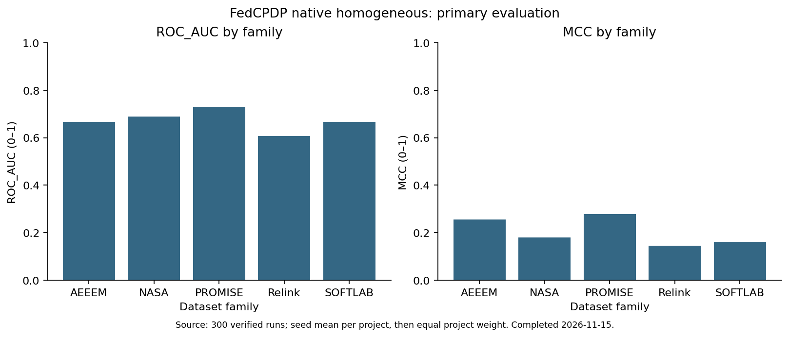

# FedCPDP 原生同构实验：结果与复现说明

2026-11-15 18:28 完成训练，18:29 全部核验通过。30 个目标项目 × 10 个种子 = 300 个模型，每个 50 轮，失败 0。

## 结果口径

先对每个目标项目的 10 个训练种子取均值，再对项目等权平均；家族不是等权。固定源划分下的训练种子标准差不是重新划分的稳健性，也不是置信区间。主口径为源验证集项目宏 MCC 选阈值，保留固定 0.5 与验证 F1 两种补充结果。900 行评价记录代表 300 个模型 × 3 种阈值，不是 900 次训练。

主口径：ROC_AUC **0.6897**，MCC **0.2255**，Recall **0.5429**，G_mean **0.5997**，F1 **0.3859**。

## 家族差异

- **AEEEM（5 项目）**：ROC_AUC 0.6667，MCC 0.2564，Recall 0.5558，G_mean 0.6370。
- **NASA（5 项目）**：ROC_AUC 0.6886，MCC 0.1796，Recall 0.5823，G_mean 0.6146。
- **PROMISE（12 项目）**：ROC_AUC 0.7303，MCC 0.2779，Recall 0.5752，G_mean 0.6359。
- **Relink（3 项目）**：ROC_AUC 0.6075，MCC 0.1453，Recall 0.5687，G_mean 0.5050。
- **SOFTLAB（5 项目）**：ROC_AUC 0.6656，MCC 0.1628，Recall 0.3977，G_mean 0.5175。

PROMISE 的家族平均 AUC 和 MCC 最高；Relink 的平均 AUC 最低。所有 30 个项目的种子平均 MCC 均为正，但这不证明相对其他方法的优势。

## 阈值与工作量

固定 0.5：MCC 0.2257，Recall 0.5854，G-mean 0.6146。相对主口径，Recall 高 0.0425；源验证集最优阈值不保证迁移后更好。继续保留预先指定的主口径，不按测试表现改选阈值规则。
仅 13 个项目具有全部有效的正 LOC。其项目等权 CostEffect@20 = 0.3092，Popt@20 = 0.3472。20% LOC 检查预算下平均发现约 30.92% 的缺陷实体（按概率/LOC排序和线性插值）；不是实际 bug 个数。其余 17 项记缺失，不当作零。

## 实验定义与限制

本次调用未修改的作者 federated_round/local_train/aggregate，以训练损失参与 hybrid 聚合；源验证只用于最终分类阈值。与此前服务器使用验证 BCE 替换聚合输入的版本不同，不能合并重复结果。此前全体其他项目作为来源的 FedCPDP 实验也保留在独立历史目录。
数据为固定作者发布的 30 个 CSV；五家族内部留一项目，源约 80/20，目标全部测试。原始行号与既有 FLR / ALMITY 20261114 冻结划分一致，但预处理与原生模型、预算不同。保留客户端内分组及源—目标重复排除，不进行跨客户端重复联合分组；这是用户选定协议，不宣称全局无重复泄漏。
原生 Z-score/哈希/MLP 与目标无标签自归一化保留。50轮、5本地epoch、batch32；其余详见 protocol.json。DP 显式开启 C=1、sigma=0.1，但没有经过核验的总 epsilon/delta，不能称完整隐私保证。作者近似 focal 梯度与部分对齐反传不作改写。Sigmoid exp 溢出警告保留，最终预测有限并通过检查点重算；未因测试结果修改代码或调参。
这属于声明配置下的作者实现同构实验，不是原论文数值严格复现；不据此宣称统计显著优于其他方法。

## 已发布内容

- `metrics_records.json` 与 `runs/`：300 项指标、目标预测、源验证预测、特征映射和完成轮次。
- `all_runs.csv`、`project_summary.csv`、`family_summary.csv`：三种评价条件及种子均值/标准差/计数。
- `analysis.json`：本报告的项目等权汇总。
- `verification.json`、`completion_record.json`、`preflight.json`：完成与原生一致性核验记录。
- `local_artifact_sha256.json`：原始运行产物哈希。模型 pickle、日志和第三方原始数据保留本地，未提交 Git；源码和锁定数据获取脚本可重跑。

代码见 [原生同构实验](../../experiments/homogeneous/fedcpdp-native-20261114/PUBLICATION.md)。
