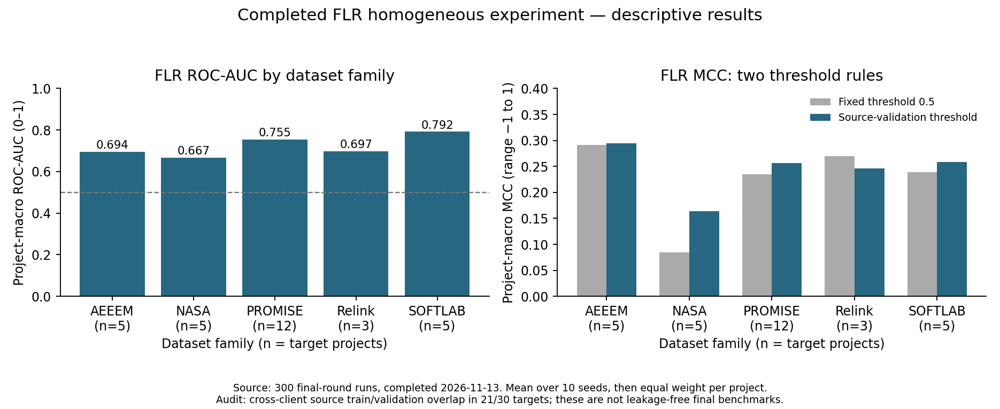

# FLR 同构实验：结果分析与审计限制

**完成情况：30 个目标项目 × 10 个训练种子，共 300 次；每次 100 轮。2026-11-13 完成。**

**重要限制：21 个目标任务存在跨源客户端的训练—验证重复特征重叠。** 单个客户端内部的分组隔离及源—目标重复排除成立，但同一特征记录仍可能在客户端 A 的训练集和客户端 B 的验证集中出现。这可能影响验证阈值选择；影响方向和大小尚未通过修正后的重跑量化。数值核验通过不等于实验协议无泄漏。本报告保留历史结果，不将其当作严格无泄漏的最终主比较。

## 汇总口径

先对每个目标项目的 10 个种子取均值，再对项目等权平均。30 个项目是项目级描述单位，300 次重复不是 300 个独立项目。标准差为同一固定划分下 10 个训练种子的样本标准差（ddof=1），不是置信区间。不同家族包含不同数量的项目；总体均值不是五个家族均值的简单平均。

## 总体结果

主口径（源验证集选择阈值）：ROC-AUC **0.7305**，MCC **0.2467**，Recall **0.4820**，G-mean **0.5444**，F1 **0.3635**。

固定阈值 0.5：MCC 0.2233，Recall 0.2363，G-mean 0.4233，F1 0.2810。源验证阈值对应的项目平均 Recall 增加 0.2456，MCC 增加 0.0234。这描述两种预定评价规则的差异，不以目标测试成绩重新选择规则；ROC-AUC 和工作量指标不依赖分类阈值。

## 数据家族差异

- **AEEEM（5 个项目）**：AUC 0.6944，MCC 0.2950，Recall 0.4049，G-mean 0.5920；工作量指标覆盖 0 个项目。
- **NASA（5 个项目）**：AUC 0.6670，MCC 0.1641，Recall 0.4146，G-mean 0.4572；工作量指标覆盖 2 个项目。
- **PROMISE（12 个项目）**：AUC 0.7548，MCC 0.2561，Recall 0.6275，G-mean 0.5819；工作量指标覆盖 3 个项目。
- **Relink（3 个项目）**：AUC 0.6970，MCC 0.2464，Recall 0.3131，G-mean 0.5074；工作量指标覆盖 3 个项目。
- **SOFTLAB（5 个项目）**：AUC 0.7919，MCC 0.2587，Recall 0.3783，G-mean 0.5163；工作量指标覆盖 5 个项目。

SOFTLAB 的家族平均 AUC 最高，NASA 最低；AEEEM 的 MCC 最高。这是数据家族之间的描述差异，不能解释为对某个方法的优越性证明。Relink 的源验证阈值 MCC 低于固定 0.5，说明源阈值迁移并不总能改善目标结果。

## 项目差异与随机重复

项目平均 AUC 较高的是 ar5（0.9420）、tomcat（0.8148）、ant-1.7（0.8087）；较低的是 MW1（0.5263）、camel-1.6（0.6025）、ML（0.6038）。ar5 仅 36 条目标记录、8 个缺陷样本，不宜从单个小项目推断普遍效果。

30 个项目的主口径平均 MCC 均为正；最高的项目内 AUC 标准差约 0.00144（ar3），但 MCC 标准差最高约 0.1203（ar5）。排序分数的随机变化较小，不代表离散阈值指标同样稳定，也不代表对重新划分数据的稳健性。

## 工作量指标

仅 **13/30 个项目**具有全部有效的正 LOC。按这 13 个项目等权平均，CostEffect@20 = **0.3655**，Popt@20 = **0.3903**。前者表示在当前按概率/LOC 排序及分数插值规则下，平均投入 20% LOC 检查预算可发现约 36.55% 的缺陷实体。这里的标签是二分类缺陷实体，不是实际缺陷个数。其余 17 个项目保留分类评价，工作量指标记为缺失，不能当作零。AEEEM 全部不适用工作量指标。

## 与其他实验的关系

FLR 使用同家族源项目、逻辑回归、100 轮、10 个种子；既有 FedCPDP 使用其他全部 29 个项目、原生 MLP/哈希、50 轮、3 个种子并提供集成。两者不能直接排序或做配对优劣检验。camel/ar1 没有被预留为公开蒸馏池，因此本批也不是 FedDP 公共辅助数据条件的对照。当前数据是作者发布版本，并非逐项目重新选择的最新版。目标自身无标签特征用于 minmax，属于传导式目标访问。

## 复核与文件

- `metrics_records.json`：300 个任务的原始项目级指标，含主阈值和固定阈值口径。
- `all_runs.csv`：600 行（300 个模型 × 两种阈值），不是 600 次训练。
- `project_summary.csv`：每个目标的均值、标准差、计数。
- `family_summary.csv`：先种子平均再项目等权的家族汇总；缺失值只在有效项目上计算。
- `analysis.json`：本报告的机器可读聚合数据及覆盖数量。
- `verification.json`：历史检查程序输出；`audit.json`：新增完整审计，覆盖全部分类指标、全部工作量预算、阈值、最终权重和预测一致性，并列出重复重叠。
- 原始逐样本预测、数据、模型检查点保留在本地，不随本次源码发布；审计文件记录其 SHA256。

现有结果可用于描述基线行为、排查协议和形成后续实验假设。若用于最终严格比较，应先跨全部源客户端统一处理重复特征分组，再冻结统一协议并重跑受影响任务；不在本次发布中偷偷更换划分或覆盖结果。
